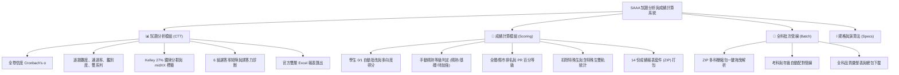

# SAAA 縣市學生學習能力檢測 ｜ 試題分析與成績計算系統 (Vue 3 旗艦重構版)

<div align="center">

[](https://github.com/SAAA-ntcu/saaa-item-analysis/actions/workflows/ci.yml)
[](https://github.com/SAAA-ntcu/saaa-item-analysis/actions/workflows/release-desktop.yml)
[](https://v2.tauri.app/)


[](https://github.com/SAAA-ntcu/saaa-item-analysis)


**國立臺中教育大學 ｜ 測驗統計與適性學習研究中心 (NTCU IER)**  
*Students' Academic Attainment Assessment (SAAA) Item Analysis & Score Calculation System*

> 🔒 **100% 本機離線運算** · **零個資上傳** · **支援跨平台原生桌面應用程式 (Windows .msi/.exe, macOS .dmg) 與純瀏覽器免安裝運行** · **專門適配 SAAA 學力檢測 CTT 試題分析與成績處理**

[線上直接使用 (GitHub Pages)](https://saaa-ntcu.github.io/saaa-item-analysis/) · [下載桌面版 (GitHub Releases)](https://github.com/SAAA-ntcu/saaa-item-analysis/releases) · [回報問題](https://github.com/SAAA-ntcu/saaa-item-analysis/issues)

</div>

---

## 📖 專案緣起與重構背景

本專案為 **縣市學生學習能力檢測 (SAAA)** 之核心數據處理與品質診斷系統。系統原始以 R 語言（`114M3+1A.R`、`35_ctt.R`、`30_scoring.R`、`40_summaries.R`）進行試題分析與成績統計。

為了徹底解決使用者端需繁瑣安裝 R 語言環境、依賴多個 R 套件、且執行大型測驗耗時冗長之痛點，本專案基於 **Vue 3 + Vite** 進行全方位架構重構：
1. **極速運算**：純 JavaScript 雙引擎架構，在瀏覽器端本機只需數秒即可完成 **65,000+ 筆** 學生原始資料的批改計分、常模分群與試題分析。
2. **視覺美學全面對齊 [`saaa-vue`](https://github.com/SAAA-ntcu/saaa-vue)**：完整承襲官方 **莫蘭迪文青活頁手帳（Morandi Academic Notebook）** 風格，提供包含手帳外殼、金屬裝訂環、燕尾書籤、彩色索引標籤與互動折線趨勢圖。
3. **100% 精準對齊 R 語言**：採用自研純整數 BigInt 算術四捨五入算法，徹底消滅二進位浮點誤差，全卷信度 Cronbach's $\alpha$、高低分組切點、各題通過率與鑑別度一人不差、一分不差。
4. **Tauri v2 跨平台桌面封裝**：比照 [`SAAA-Deidentification-Tool`](https://github.com/SAAA-ntcu/SAAA-Deidentification-Tool) 標準，支援 Windows 安裝檔 (`.exe`, `.msi`)、macOS 應用檔 (`.dmg`)、免安裝離線 ZIP 與 GitHub Pages 線上版。

---

## 💻 全平台使用方式 (Windows / macOS / 網頁免安裝 / 線上版)

本系統為各級學校教師、資訊組長與研究人員提供四種使用管道，所有管道皆為 **100% 本地運算、絕不上傳任何個資或題目至雲端**：

### 🪟 Windows 教師使用指南 (推薦桌面版)

Windows 老師可至 [GitHub Releases 發布頁面](https://github.com/SAAA-ntcu/saaa-item-analysis/releases) 下載專屬安裝檔：

| 檔案類型 | 推薦對象 | 特點說明 |
|---|---|---|
| **`*.exe` (NSIS 安裝檔)** | 國小 / 國中一般教師 | 繁體中文精靈引導，雙擊「下一步」即可安裝完成，自動建立桌面捷徑與開始功能表圖示。支援系統原生另存新檔對話框。 |
| **`*.msi` (Windows Installer)** | 學校資訊組長 / 系統管理員 | 具備標準 Windows 封裝規格，支援 Active Directory / 群組原則 (GPO) 批次自動派送至學校電腦教室。 |

---

### 🍎 macOS 教師使用指南 (原生桌面版)

1. 至 [Releases 頁面](https://github.com/SAAA-ntcu/saaa-item-analysis/releases) 下載 `SAAA_Item_Analysis_macOS.dmg`。
2. 雙擊開啟 `.dmg`，將 **「SAAA試題分析系統」** 拖曳至 **「Applications (應用程式)」** 資料夾。
3. 於應用程式清單中點擊啟動即可。原生 Apple Silicon / Intel 雙架構支援，超輕量極致效能。

---

### 🌐 方案三：免安裝純網頁離線版 (ZIP 下載，拔掉網路線可用)

1. 至 [Releases 頁面](https://github.com/SAAA-ntcu/saaa-item-analysis/releases) 下載 `SAAA_Item_Analysis_Offline.zip`。
2. 解壓縮後，**直接點兩下打開 `index.html`**。
3. 所有相依套件皆已本機化於資料夾中，在完全無網路的環境下亦可流暢運行。
4. 另外提供單一 HTML 檔案版 `SAAA試題分析系統.html`（僅 121 KB），隨身碟隨插隨開！

---

### 🚀 方案四：GitHub Pages 線上直接使用 (零下載、零安裝)

直接點擊前往：**[SAAA 試題分析與成績計算系統 線上版](https://saaa-ntcu.github.io/saaa-item-analysis/)**  
直接將答案檔與學生作答檔拖入網頁，即可在瀏覽器記憶體中完成分析與下載。

---

## 🎨 設計美學（Morandi Academic Notebook）

系統介面完全移植自官方 [`saaa-vue`](https://github.com/SAAA-ntcu/saaa-vue) 前端工程：

- **莫蘭迪色盤（Morandi Color Tokens）**：
  - **主色 (Primary)**：`#52796f`（鼠尾草綠，沈穩典雅的學術主調）
  - **深色 (Primary Dark)**：`#354f52`（深石青綠，按鈕 Hover 與標題強調）
  - **淺色 (Primary Light)**：`#edf2ee`（薄荷白，選中膠囊標籤）
  - **赤陶磚紅 (Terracotta)**：`#c47c5d`（成績計算主色、裝訂扣環）
  - **珊瑚橘 (Coral)**：`#e07a5f`（難度曲線、弱題警戒紅點）
  - **書籤與標籤**：燕麥黃 (`#d4a373`)、復古青石 (`#2f3e46`)、乾燥玫瑰 (`#c87d8a`)、暖杏黃 (`#e9c46a`)、青草綠 (`#7ea172`)
- **活頁手帳筆記本（Notebook Binder Frame）**：
  - 外層莫蘭迪漸層活頁夾殼體，具備立體包覆線條與柔和陰影。
  - 左側 26 組金屬裝訂環（雙層孔洞與赤陶夾扣）。
  - 頂部燕麥黃與青石灰燕尾書籤（支援滑鼠懸浮彈跳與快速換頁）。
  - 右側彩色活頁索引標籤（可一鍵切換「試題分析」、「成績計算」、「全科批次」）。
  - 手帳底角可愛閱讀男孩 (`read_boy.png`) 與女孩 (`read_girl.png`) 插畫。
- **互動折線趨勢圖（對齊 `ItemAnalysisTab.vue`）**：
  - 試題分析完成後，即時繪製全卷通過率 $P$、難度 Index 與鑑別度 $D$ 趨勢圖。
  - **弱題標示**：通過率 $< 0.40$ 或鑑別度 $< 0.20$ 的題目自動點亮紅點，提醒檢視誘答力。
  - **自適應 Tooltip**：滑鼠移入題號時，即時顯示該題指標與品質診斷建議。

---

## 📐 系統功能模組



---

## 🔬 演算法核心規格與四捨五入核心

### 1. 純整數 BigInt 算術四捨五入 (Pure Integer Round-Half-Up 至 0.00)
傳統浮點運算常因二進位微差產生「0.605 變成 0.60」或「0.435 變成 0.43」的誤差。本系統採用純整數公式：

$$\text{Rounded}(k, n) = \text{sign} \times \left\lfloor \frac{2 \times 10^{\text{digits}} \times |k| + |n|}{2 \times |n|} \right\rfloor \div 10^{\text{digits}}$$

搭配 BigInt 與正負號嚴格保護，確保所有難度、通過率、鑑別度與選答率 100% 精準對齊 R 語言標準規範。

### 2. 精熟等級三級劃分規則
- **精熟 (Mastery)**：答對題數 $\ge$ 手動輸入之精熟門檻題數。
- **基礎 (Basic)**：答對題數 $\ge$ 手動輸入之基礎門檻題數，且小於精熟門檻。
- **待加強 (Needs Improvement)**：答對題數 $<$ 基礎門檻題數。

> [!IMPORTANT]
> 系統嚴格遵循**「精熟等級不自動預設，需使用者手動輸入門檻題數；無輸入則安全略過等級判定」**之規範。

### 3. Kelley 27% 鐵律極端組分群
高低分組嚴格取 Kelley 經典 27% 極端組切點，中分組比例由公式動態決定：

$$\text{midRatio} = 1.0 - \text{hnRatio} - 0.27 - 0.01$$

中分組欄位名稱精確對齊 R 語言輸出（如 `mid67`、`mid69`、`mid70`）。

### 4. 測驗年級正序支援
嚴格支援以下年級正序：
$$\text{3 年級} \rightarrow \text{4 年級} \rightarrow \text{5 年級} \rightarrow \text{6 年級} \rightarrow \text{7 年級} \rightarrow \text{7n (七年級新生)} \rightarrow \text{8 年級}$$
七年級與七年級新生清楚區隔，答案欄位與題目選項自動適應國小（1~4）與國中（A~D）。

---

## 📊 真實數據驗證報告 (Ground Truth Verification)

使用 SAAA 真實測驗中 **65,000+ 筆** 學生原始作答數據進行全量驗證：

| 檢驗指標 / 科目 | 國語文 (21,400 人) | 數學 (21,371 人) | 英語 (21,408 人) | 驗證結論 |
| :--- | :---: | :---: | :---: | :---: |
| **信度 Cronbach's $\alpha$** | | | | |
| ・R 語言原始計算 | **0.8348** | **0.8207** | **0.9462** | **100% 一致** |
| ・Vue 3 系統計算 | **0.8348** | **0.8207** | **0.9462** | |
| **有效受試者人數 ($N$)** | | | | |
| ・R 語言原始篩選 | **21,400 人** | **21,371 人** | **21,408 人** | **一人不差** |
| ・Vue 3 系統篩選 | **21,400 人** | **21,371 人** | **21,408 人** | |
| **Kelley 極端組切點** | | | | |
| ・低分組門檻 | $\le 18$ 分 (31.13%) | $\le 9$ 分 (30.22%) | $\le 16$ 分 (28.55%) | **完全相同** |
| ・高分組門檻 | $\ge 24$ 分 (31.89%) | $\ge 16$ 分 (29.89%) | $\ge 33$ 分 (29.08%) | **完全相同** |
| ・中分組名稱標籤 | `mid67` | `mid69` | `mid70` | **完全相同** |
| **平均通過率 / 難度** | 0.66 / 0.68 | 0.53 / 0.51 | 0.65 / 0.69 | **完全相同** |

---

## 🛠️ 快速開始 (Quick Start)

### 環境需求
- [Node.js](https://nodejs.org/) v18.0.0 以上 (建議 v20 或 v22)
- [npm](https://www.npmjs.com/) v9.0.0 以上

### 安裝與啟動
```bash
# 1. 複製專案
git clone https://github.com/SAAA-ntcu/saaa-item-analysis.git
cd saaa-item-analysis

# 2. 安裝依賴套件
npm install

# 3. 啟動本機開發伺服器
npm run dev

# 4. 編譯生產環境靜態網頁 (dist/)
npm run build

# 5. 執行 65,000+ 筆實測資料基準測試
npm test
```

### 命令列 CLI 批次執行
本系統亦支援在後台無介面執行命令列批次作業：
```bash
# 執行 CTT 試題分析 CLI
npm run cli:ctt -- -a 答案檔.xlsx -r 作答檔.xlsx -s C -g 7n

# 執行 成績計算 CLI
npm run cli:scoring -- -a 答案檔.xlsx -r 作答檔.xlsx -s C -g 7n -m 23 -b 15
```

### 🖥️ 桌面原生應用程式 (Tauri v2) 開發與建置

```bash
# 本機開發模式 (啟動 Vite + 原生 WebView 視窗)
npm run tauri:dev

# 編譯桌面原生安裝檔 (Windows .exe, .msi / macOS .app)
npm run tauri:build
```

---

## ⚙️ 打包原理與 CI/CD 自動化流程 (比照 SAAA 去識別化工具)

本專案全面比照 [`SAAA-Deidentification-Tool`](https://github.com/SAAA-ntcu/SAAA-Deidentification-Tool) 規格建置高安全、極輕量之原生桌面與離線打包流程：

1. **極致輕量原生核心 (Tauri v2 + Rust)**：
   - 捨棄傳統 Electron 肥大體積（150+ MB），採用作業系統內建之 Webview2 (Windows) 與 WebKit (macOS)，編譯後程式碼僅數 MB。
   - 原生系統另存新檔對話框 (`save_bytes` IPC 命令)：在桌面版點擊匯出 Excel 或 ZIP 時，直接啟動作業系統原生的另存對話框，避免瀏覽器下載攔截。
2. **多平台安裝檔規格**：
   - **Windows**：產出 `*.exe` (NSIS 繁體中文一鍵安裝引導精靈) 與 `*.msi` (標準 Windows Installer，便於教育局端與資訊組長透過 AD GPO 大量派送)。
   - **macOS**：利用 macOS 核心 `hdiutil` 自動生成含 `/Applications` 拖曳安裝捷徑之 `.dmg` 映像檔與 `.app.zip` 綠色版。
   - **離線純網頁版**：產出 `SAAA_Item_Analysis_Offline.zip` 與單檔離線版 `SAAA試題分析系統.html`。
3. **GitHub Actions 雲端四軌自動化發布 (`release-desktop.yml`)**：
   - 當推送版本標籤（例如 `git tag v2.0.0 && git push origin v2.0.0`）或在 Actions 頁面手動點擊觸發時，平行啟動：
     - `build-windows` (windows-latest)
     - `build-macos` (macos-latest)
     - `build-offline-zip` (ubuntu-latest)
     - `publish-release` (ubuntu-latest)：匯總所有平台安裝檔，自動建立 GitHub Release 並產生繁體中文下載指引。
4. **程式碼品質與隱私防護 (`ci.yml`)**：
   - 自動執行 65,000+ 筆實測數據的地面真值（Ground Truth）測試、Vite 編譯檢測，並主動掃描以防學生個人真實名冊誤推至公開倉庫。

---

## 📂 專案目錄結構

```
saaa-item-analysis/
├── .github/
│   └── workflows/
│       ├── release-desktop.yml # 🪟🍎 自動編譯 Windows (.msi/.exe) 與 macOS (.dmg) 並發布 Release
│       ├── deploy.yml          # 🚀 自動部署 SAAA 網頁工具至 GitHub Pages
│       └── ci.yml              # 🛡️ 單元測試、編譯檢驗與敏感資料防護
├── src-tauri/                  # 🖥️ Tauri v2 跨平台原生桌面核心
│   ├── Cargo.toml              # Rust 專案相依設定 (tauri-plugin-dialog, tauri-plugin-fs)
│   ├── tauri.conf.json         # 視窗外觀、NSIS 繁體中文、打包規格設定
│   ├── build.rs                # Tauri 建置腳本
│   ├── icons/                  # 高解析度跨平台 App 圖示 (.ico, .icns, .png)
│   └── src/
│       ├── main.rs             # 桌面程式進入點
│       └── lib.rs              # save_bytes 原生另存新檔系統對話框 IPC 命令
├── public/
│   └── images/                 # 莫蘭迪手帳背景、閱讀男孩女孩、官方 Logo
├── src/
│   ├── assets/                 # 靜態資源
│   ├── components/
│   │   ├── layout/
│   │   │   ├── AppHeader.vue   # 頂部毛玻璃導覽列 (Logo、Tab膠囊)
│   │   │   ├── NotebookFrame.vue# 莫蘭迪活頁筆記本外框 (裝訂環、書籤、標籤)
│   │   │   └── AppFooter.vue   # 底部資訊與版權列
│   │   └── tabs/
│   │       ├── CttTab.vue      # 試題分析 (CTT) 介面與報表
│   │       ├── ScoringTab.vue  # 成績計算介面與多層級報表
│   │       ├── BatchTab.vue    # 全科批次處理管線
│   │       ├── AboutTab.vue    # 演算法規格與四捨五入說明
│   │       └── ItemTrendChart.vue# 互動折線趨勢圖 (含弱題紅點標示)
│   ├── core/
│   │   ├── math.js             # BigInt 純整數 0.00 四捨五入與統計公式
│   │   ├── ctt.js              # CTT 試題分析核心引擎
│   │   ├── scoring.js          # 學生作答解析與向度計分引擎
│   │   ├── summaries.js        # 縣市/學校/班級等級描述彙總引擎
│   │   ├── exporter.js         # ExcelJS 官方綠底表頭報表渲染引擎
│   │   └── constants.js        # SAAA 科目、年級與樣式常數
│   ├── utils/
│   │   └── download.js         # 混合下載引擎 (Tauri 原生 save_bytes / 瀏覽器 fallback)
│   ├── cli/                    # CLI 命令列獨立執行工具
│   ├── App.vue                 # 根元件
│   ├── main.js                 # 應用程式入口
│   └── style.css               # Tailwind CSS 與莫蘭迪主題變數
├── test/
│   └── test_ground_truth.js    # 65,000+ 筆實測數據驗證腳本
├── SAAA試題分析系統.html        # 桌面單檔極速離線版 (121 KB，免開伺服器)
├── index.html                  # Vite SPA 入口
├── vite.config.js              # Vite 建置設定 (支援相對路徑與 Pages)
├── tailwind.config.js          # Tailwind 主題顏色擴充
└── package.json
```

---

## 📜 授權協議 (License)

本專案基於 [MIT License](LICENSE) 條款開源發布。  
版權所有 © 2026 **國立臺中教育大學 測驗統計與適性學習研究中心 (NTCU IER)**。
